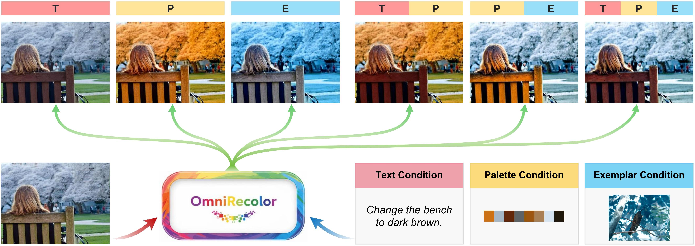

# OmniRecolor

**Compositional Multimodal Image Recoloring via Diffusion Flow Composition**


## Environment Setup

Before running OmniRecolor, follow the installation instructions in the [OmniGen2 repository](https://github.com/VectorSpaceLab/OmniGen2) to configure the environment and download the base model.

## Inference

We provide an inference script, `inference_splitrecolor.py`, for compositional image recoloring.

### Example Command

```bash
python inference_splitrecolor.py \
    --model_path "/path/to/OmniGen2" \
    --num_inference_step 50 \
    --text_guidance_scale 0.0 \
    --image_guidance_scale 0.0 \
    --prompt_1 "recolor the image using the provided palette" \
    --prompt_2 "Recolor the input image based on the color style of the reference image" \
    --instruction "Change the color of the blue car to yellow." \
    --input_image_path \
        sample/input_image.png \
        sample/palette.png \
        sample/exemplar.png \
    --output_image_path sample/output.png \
    --num_images_per_prompt 1 \
    --transformer_lora_path "/path/to/transformer_lora"
```

Replace `/path/to/OmniGen2` and `/path/to/transformer_lora` with the actual paths to your downloaded base model and fine-tuned LoRA weights.

### Input Images

The `--input_image_path` argument takes three image paths:

1. **Input image** (`input_image.png`): The source image to be recolored.
2. **Color palette** (`palette.png`): The palette providing the desired colors.
3. **Exemplar image** (`exemplar.png`): The reference image providing the desired color style.

### Key Arguments

| Argument | Description |
|---|---|
| `--model_path` | Path to the downloaded OmniGen2 base model |
| `--num_inference_step` | Number of inference steps |
| `--text_guidance_scale` | Text guidance scale |
| `--image_guidance_scale` | Image guidance scale |
| `--prompt_1` | Prompt associated with palette-guided recoloring |
| `--prompt_2` | Prompt associated with exemplar-guided recoloring |
| `--instruction` | Text instruction describing the desired recoloring |
| `--input_image_path` | Paths to the source image, palette image, and exemplar image |
| `--output_image_path` | Path to save the generated image |
| `--num_images_per_prompt` | Number of images generated per prompt |
| `--transformer_lora_path` | Path to the fine-tuned transformer LoRA weights |

## Flow Composition Parameters

The flow composition parameters \(p\), \(r\), and \(t\) can currently be adjusted in the `aggregate_spatial` function in:

```text
OmniRecolor_code/
└── omnirecolor/
    └── pipelines/
        └── omnirecolor/
            └── pipeline_split_omnirecolor.py
```

Modify the corresponding parameters passed to `aggregate_spatial` to experiment with different flow composition settings.

These parameters are currently configured in the source code rather than exposed as command-line arguments.
